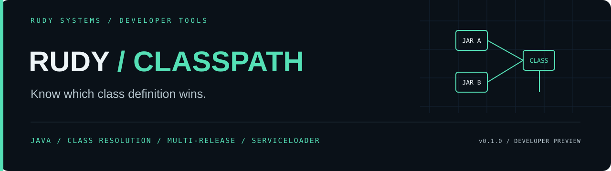

<p align="center"></p>

<p align="center">
 <a href="https://github.com/r4venrudy/rudy-classpath/actions/workflows/ci.yml"></a>
 
 
 <a href="LICENSE"></a>
</p>

<p align="center"><strong>Know which class definition wins.</strong></p>
<p align="center"><a href="#capabilities">Capabilities</a> · <a href="#install">Install</a> · <a href="#try-it">Examples</a> · <a href="docs/CONTRACT.md">Contract</a> · <a href="https://rudy.systems">Rudy Systems</a></p>

---

**Rudy Classpath finds conflicting Java class definitions before a rollout.**
Supply an ordered set of JARs and a target Java version. It selects effective
multi-release entries, explains the first provided definition of a class, checks
bytecode-version compatibility, and reviews package sealing and ServiceLoader
metadata. Compare two classpaths to see which definitions and origins change.

The core is **Java**, with no external runtime libraries or build plugins. Java
provides direct access to ZIP, class-file encodings and JVM archive APIs, and the
result ships as one portable executable JAR.

**v0.1.0 developer preview.** This is a bounded model of the explicit JAR list.
It never defines or executes target classes. It does not reconstruct custom
classloaders, resolve modules, verify JAR signatures, inspect nested application
archives, perform complete bytecode/linkage verification, or establish an exploit.

```text
ordered JARs + target Java + preview policy
                    │
         bounded compressed snapshots / CRC checks
                    │
         effective multi-release entry selection
                    │
       ┌────────────┼─────────────────┐
       ▼            ▼                 ▼
 class conflicts  sealing / SPI   before / after
       │            │                 │
       └────── JSON / SARIF / CI gates ┘
```

## Capabilities

| Capability | Implemented behavior |
| :--- | :--- |
| Ordered resolution | Lists every provided definition and identifies the first provided JAR for each effective binary name |
| Duplicate triage | Distinguishes byte-identical copies from competing class bytes |
| Multi-release JARs | Honors `Multi-Release: true`, chooses the highest eligible version ≥9, and ignores versioned META-INF metadata |
| Class compatibility | Checks major/minor headers, target version, preview opt-in, declaration/path consistency and versioned-directory ceilings |
| Sealing review | Finds packages spanning origins when a participating manifest seals the package, including section overrides |
| ServiceLoader review | Merges descriptor order, removes repeated provider names, reports missing definitions and incompatible constructor/class flags |
| Classpath comparison | Added/removed binary names, changed provider inventories and changed effective class bytes |
| Review outputs | Canonical JSON, text summaries, SARIF 2.1.0 and configurable exit gates |
| Bounded input | Compressed/uncompressed byte budgets, entry/provider limits, CRC verification and strict metadata parsing |

The model covers **ordinary JARs on one explicit classpath**. Parent/platform
loaders can supply classes first, and manifests can add URLs to a real runtime
classpath. Manifest `Class-Path` is reported as an error-level coverage finding
and is never followed. A reported first provider is a prediction within the
supplied list, not proof of what a production process loaded.

## Install

Download the executable JAR or example distribution from
[Releases](https://github.com/r4venrudy/rudy-classpath/releases). Verify downloads
against `SHA256SUMS.txt`. Running the packaged tool requires **Java 21 or newer**;
no Maven, Gradle, Python, JavaScript, network service or API key is required.

```sh
java -jar rudy-classpath-0.1.0.jar --version
```

To build, use a **JDK 21 or newer**, from the project root:

```sh
git clone https://github.com/r4venrudy/rudy-classpath.git
cd rudy-classpath
java tools/Build.java test
java tools/Build.java package
java -jar dist/rudy-classpath-0.1.0.jar --version
```

The build uses the standard JDK compiler with `--release 21`, all compiler
warnings enabled and warnings treated as errors. Packaging refuses to overwrite
an existing versioned artifact; use a clean checkout for release builds.

## Try it

All bundled JARs contain **synthetic demonstration classes**. Options precede file
arguments. Paths containing spaces should be quoted by your shell.

```sh
# Both JARs provide demo.Version with different method bodies.
java -jar dist/rudy-classpath-0.1.0.jar scan --target 21 --fail-on none examples/library-a.jar examples/library-b.jar

# Explain every provider and the first one selected by the explicit-list model.
java -jar dist/rudy-classpath-0.1.0.jar explain demo.Version examples/library-b.jar examples/library-a.jar

# Target 17 selects the Java 8 base class; target 21 selects its versioned override.
java -jar dist/rudy-classpath-0.1.0.jar scan --target 17 examples/multi-release.jar
java -jar dist/rudy-classpath-0.1.0.jar scan --target 21 examples/multi-release.jar

# Reversing the conflicting libraries changes the effective class bytes.
# This command intentionally exits 1 and retains its JSON comparison.
java -jar dist/rudy-classpath-0.1.0.jar compare --fail-on-change examples/before.classpath examples/after.classpath
```

`library-a.jar` supplies a `value()` method returning 1; `library-b.jar` supplies
one returning 2. The multi-release fixture has a Java 8 base and Java 21 override.
The tool **reads** these definitions; it never calls the methods. Tests execute
only their own generated fixture classes to compare predictions with real JDK APIs.

### Classpath list files

`compare` accepts two UTF-8 text lists, one JAR path per line. Relative paths are
resolved against the list file's directory. Leading/trailing whitespace is
trimmed; blank lines and lines starting `#` are ignored. Paths are plain text,
without shell expansion, wildcards or quote interpretation.

### Reports and gates

Scan defaults to target Java **21**, preview disabled, JSON and `--fail-on error`.
Targets 8–25 are supported. `--enable-preview` permits preview class headers only
for the exact selected target, not preview classes from older Java releases.

Use `--format sarif` for pipeline collection or `--format text` for a summary.
`--fail-on warning` includes warnings and errors; `none` collects reports.

| Exit | Meaning |
| :--- | :--- |
| 0 | Completed below the selected scan gate, or completed an explanation/comparison |
| 1 | Scan findings reached the threshold, or optional comparison gate detected a class-provider change |
| 2 | Rejected input, unsupported usage, I/O failure or a documented resource limit |

Output goes to stdout; diagnostics go to stderr. Threshold failures still emit
their complete report. Explanations return `found: false` for absent names.
Comparisons preserve both scans' findings but gate **class-provider changes**
only; run `scan` separately to enforce the current classpath policy.

## Validation and architecture

Tests compile real synthetic class files and use independent JDK behavior:
isolated `URLClassLoader` resolution, explicit-version `JarFile` selection,
package-sealing failures and generated `ServiceLoader` providers. They also cover
preview headers, malformed structures, duplicate ZIP names, CRCs, archive bounds,
manifest continuations, service limits, deterministic subprocess output, SARIF,
CLI gates and seeded malformed/mutated class inputs.

CI runs on **Windows, Linux and macOS with JDK 21 and 25**. Every job compiles,
tests, packages and runs the executable JAR against the bundled examples. Release
automation repeats this matrix before publishing. Use the live workflow badge
for actual results; configured CI alone is not proof of passing checks.

```text
src/dev/rudy/classpath/    Archive model, class reader, metadata, reports and CLI
tests/dev/rudy/classpath/ Synthetic fixtures, independent oracles and regressions
tools/Build.java          Standard-JDK build, test and packaging entry point
examples/                Public generated JARs and before/after classpath lists
docs/CONTRACT.md          Bounds, rule IDs, modeled behavior and omissions
```

Regenerate fixtures into a new `examples` directory with
`java tools/Build.java examples` in a checkout without that directory. The generator
refuses an existing destination. Certificate/trust analysis remains a separate
task for [Rudy CertMap](https://github.com/r4venrudy/rudy-certmap).

Read the [contract](docs/CONTRACT.md), [security boundaries](SECURITY.md) and
[contribution guide](CONTRIBUTING.md). Specification references:
[JAR format and multi-release behavior](https://docs.oracle.com/en/java/javase/25/docs/specs/jar/jar.html),
[class-file format](https://docs.oracle.com/javase/specs/jvms/se25/html/jvms-4.html).

---

<p align="center"><a href="LICENSE">MIT licensed</a> · Built by <a href="https://rudy.systems">Rudy Systems</a> · <a href="https://github.com/r4venrudy">r4venrudy</a></p>
